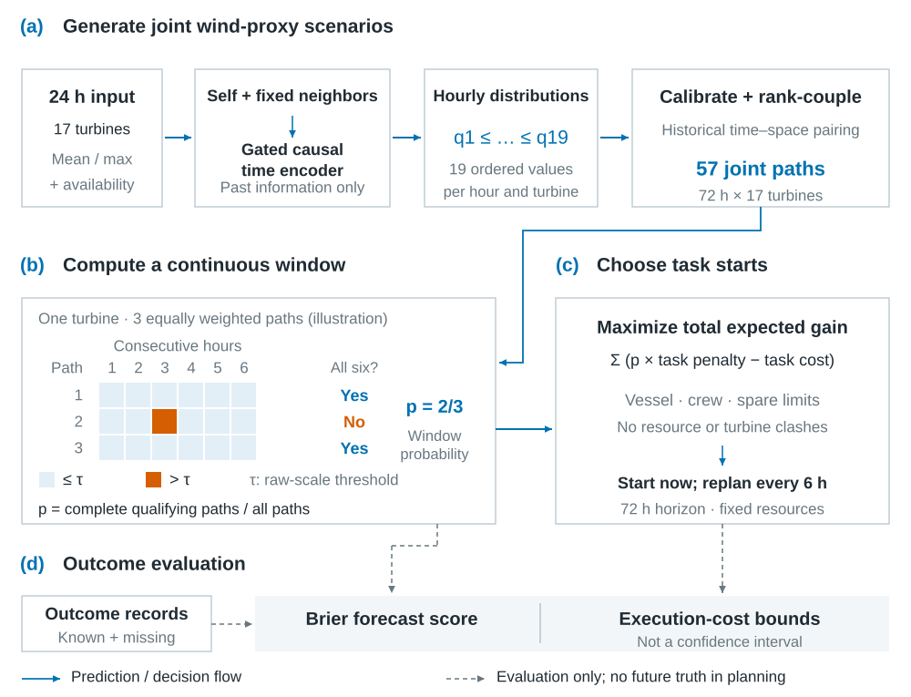
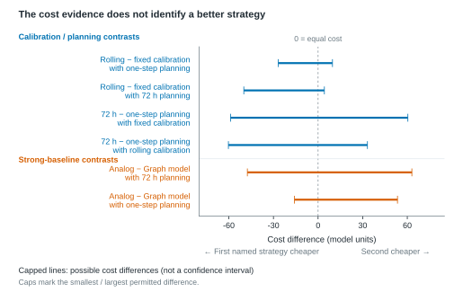

# xx wind farm: joint window forecasting and robust maintenance

[中文](README.md) · [Methods](docs/research.en.md) · [Experiments](docs/experiments.en.md) · [Synthetic demo](docs/twin.en.md) · [Runtime download](https://github.com/zhanghanhnu-coder/wind-window-research/releases/tag/v0.1.0)

**From accurate weather forecasts to usable continuous windows and identifiable maintenance value.** This project studies joint probabilistic forecasts, execution constrained by vessels, crews and spares, and conclusions supported by incomplete observations. The public case is anonymized as **xx wind farm / xx风电场**.

The repository provides bilingual methods, experiment/result figures, anonymized research source and a runnable synthetic digital-twin demonstration. **It contains no raw or cleaned observed time series, real site identity, fitted weights or private replay caches.** Empirical research and the synthetic demo are separate; the full empirical study cannot be rerun from this repository alone.



## Start here

| Goal | Entry |
|---|---|
| Understand motivation, questions and methods | [Research narrative and methods](docs/research.en.md) |
| Inspect experiments and counterexamples | [26-set figure atlas](docs/experiments.en.md) |
| Check results and their limits | [Evidence table](docs/evidence.en.md) |
| Run the 3D farm and window demo | [Digital-twin guide, API and troubleshooting](docs/twin.en.md) |
| Read algorithms and assess reproducibility | [Code map](docs/code-map.en.md) · [Reproduction guide](docs/reproducibility.en.md) |
| Understand remaining work/data needs | [Roadmap and data checklist](docs/roadmap.en.md) |
| Contribute documentation or code | [Contributing](docs/contributing.en.md) |

## Research narrative

1. **Hourly forecasts to continuous windows.** A six-hour window needs every required hour to be feasible. Equal marginals can yield different joint probabilities.
2. **Forecasts to actions.** Calibration, planning horizon, booking and irrevocable attempts influence decisions separately and require crossed comparisons.
3. **Missing observations to identifiable conclusions.** Unknown states are not imputed as success/failure. Shared physical-hour constraints bound cost/service differences and support targeted acquisition.

The originating proposal concerns accessibility-window probability forecasting and robust offshore wind maintenance with spatiotemporal weather dependence. Implemented temporal graph aggregation and joint scenarios do not imply every proposed architecture is complete or physical propagation is established.

## Status as of November 3, 2026

| Work package | Completed | Evidence still needed |
|---|---|---|
| Data and truth | Float64 revision, three-valued events, origins versus physical targets | Field units, time and quality semantics |
| Forecasting | Matched/strong baselines, dependence interventions, calibration, outages and updates | Independent year and historical forecast archives |
| Maintenance decisions | Fixed-resource crosses, separate cost/service, shared-state bounds and acquisition value | Metocean, real rules, task and cost records |
| Engineering/demo | Scenario grouping, bounded-form checks, local prototype and synthetic runtime | Field calibration and operational interfaces |
| Research materials | Manuscript materials, bilingual documentation and 26 public vector figure sets | Publication and intellectual-property records |

Forecasting covers 17 turbines and 880 origins; execution covers 44 origins. The 392 complete-input and 15 complete-weather execution origins are auxiliary subgroups. All 2024 data remain development data. Repeated targets and seeds are not additional independent observations.

## Main results: gains and limitations together

| Direction | Metric range | Interpretation |
|---|---|---|
| Graph − same-24h mean | Brier [-0.006691, -0.004739] | Graph improves matched control; the 112-day analog remains stronger |
| Original temporal structure − shuffle | Brier [-0.069800, -0.036301] | Helps overall, reverses in September–October |
| Matched-window update interaction | [0.046410, 0.084210] | Positive overall; excluding September–October crosses zero |
| Analog − graph cost | [-47.536301, 63.069760] | Overall cost ranking is unidentified |
| Analog − graph successful tasks | [-0.416667, 0.401515] | Service advantage is unidentified |

These are **missing-truth identification ranges, not confidence intervals**. Costs use model units, not realized field savings. Validly resolving the first 48 of 234 necessary states guarantees at least 35.68% narrowing of the main range. This is conditional information value, not acquired observations or realized benefit.



## Run the synthetic demo in five minutes

Python 3.10+, without third-party Python packages:

```sh
git clone https://github.com/zhanghanhnu-coder/wind-window-research.git
cd wind-window-research
python demo/server.py
```

Open `http://127.0.0.1:8788`. Windows users may double-click `start_demo.cmd`; stop with Ctrl+C. The demo includes 12 fictional turbines, power/wake/thermal response, 57 synthetic 72h paths, 6h windows and bilingual interaction. Selection uses a threshold plus capacity rule, **not the full robust optimizer**. See the [digital-twin guide](docs/twin.en.md).

```sh
python -m unittest discover -s tests -v
python -m compileall -q demo research_code
```

These checks cover public synthetic contracts and source syntax, not empirical values. See the [reproduction guide](docs/reproducibility.en.md).

## Repository layout

```text
demo/                Independent synthetic demo, browser assets and local API
research_code/       Anonymized archive; some private modules/inputs required
tests/               Six synthetic-core contract checks
results/             Five main aggregate comparisons
figures/zh, en/      26 bilingual SVG sets and title/caption catalog
docs/                Methods, experiments, evidence, runtime and roadmap
.github/workflows/   Public automated checks
```

Two of the original 28 figure sets are withheld because they locate acquisition records by real turbine/date or expose request details. Original plotting data, evidence-source metadata and the complete private figure archive are also excluded.

## Data and output boundaries

Raw SCADA, cleaned time series, real coordinates, field dictionaries, weights, per-origin predictions, action ledgers, request lists, private caches, proposals and review forms are not published. Field codes are aliased as `feature_A/B/C/D`. Renaming a site does not authorize publication of its data. Keep private material out of Issues, PRs and git history.

Next: semantic acceptance → frozen rescoring with unchanged forecasts/actions → independent-year and operational validation. See the [data checklist](docs/roadmap.en.md). Published papers, granted patents and software registration remain planned outputs; this repository does not establish their completion.

## License and citation

Project code/documentation use [MIT](LICENSE); Three.js retains its [MIT attribution](demo/static/LICENSE-three.txt). Data are outside the license. When citing, record the URL, exact commit and access date rather than an unverified paper citation or DOI. Read [Contributing](docs/contributing.en.md) before submitting changes.
