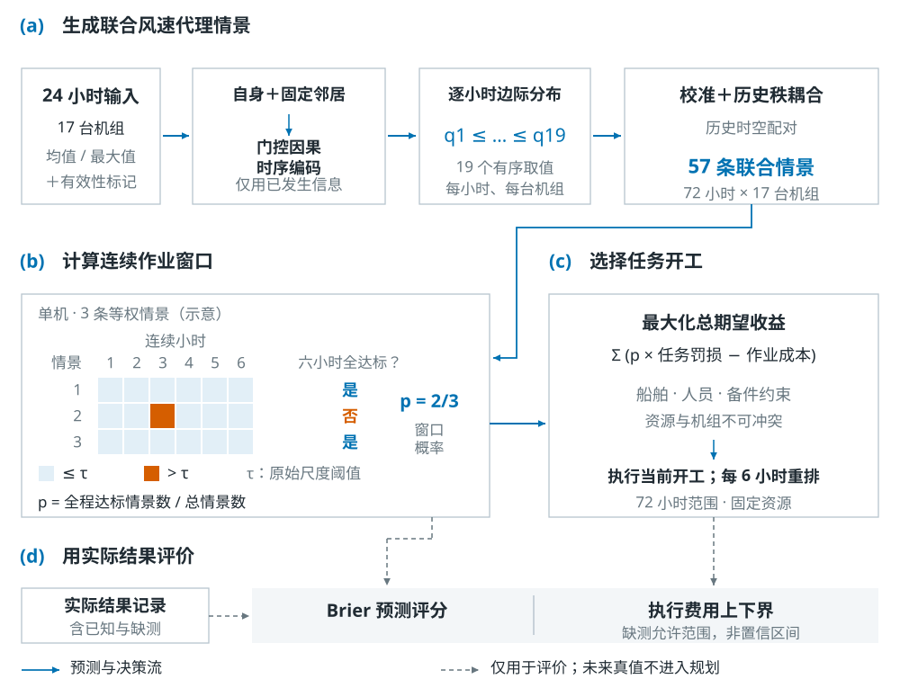
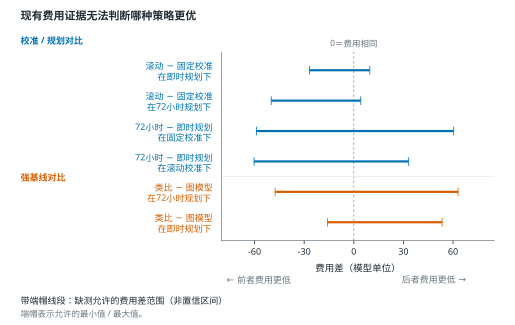

# xx风电场：联合窗口预测与鲁棒运维研究

[English](README.en.md) · [方法](docs/research.zh.md) · [实验图集](docs/experiments.zh.md) · [合成演示](docs/twin.zh.md) · [运行包](https://github.com/zhanghanhnu-coder/wind-window-research/releases/tag/v0.1.0)

**从“天气预报是否准确”推进到“连续窗口是否可用、运维收益是否可确认”。** 本项目研究联合概率预测、船—人员—备件约束下的运维执行，以及缺测数据下能被证据支持的结论。公开案例统一匿名为 **xx风电场**。

本仓库包含中英研究说明、实验与结果图、脱敏研究代码及可运行的合成数字孪生演示。**不包含任何原始或清洗后的实测时序、真实场站信息、权重和私有回放缓存。** 实证研究与合成演示分开，完整实证不能仅凭本库重跑。



## 先从哪里看

| 你的目标 | 推荐入口 |
|---|---|
| 快速理解立意、问题与方法 | [研究主线与方法](docs/research.zh.md) |
| 查看做了哪些实验、有哪些反例 | [26组实验图集](docs/experiments.zh.md) |
| 核对主要结果及其边界 | [结果证据表](docs/evidence.zh.md) |
| 跑三维机群与窗口演示 | [数字孪生指南、API与故障处理](docs/twin.zh.md) |
| 阅读算法、判断能否复现 | [代码导航](docs/code-map.zh.md) · [复现指南](docs/reproducibility.zh.md) |
| 了解剩余工作与补充数据 | [后续计划与具体清单](docs/roadmap.zh.md) |
| 贡献文档或代码 | [贡献指南](docs/contributing.zh.md) |

## 研究主线

1. **从单小时到连续窗口。** 6小时全部满足条件才构成窗口；相同边际概率可以产生不同联合事件概率。
2. **从预测到行动。** 校准、规划时域、资源预订和已执行承诺分别影响决策，需要交叉对照。
3. **从缺测到可识别结论。** 未知不直接填成成功或失败，用共享物理小时约束给出费用/服务差范围，再计算补录价值。

项目源于“考虑气象时空传播特性的海上风电场可达性窗口概率预测与鲁棒运维调度方法研究”。已实现的时序图汇聚与联合情景不等于全部申请架构，也不证明物理传播机理。

## 当前进度（截至2026-11-03）

| 工作包 | 已完成 | 仍待补证 |
|---|---|---|
| 数据与标签 | float64复评、三值真值、起报/物理目标区分 | 字段单位、时间与质量语义 |
| 预测方法 | 同信息/强基线、联合干预、校准、缺测与更新诊断 | 独立年度与真实预报档案 |
| 运维决策 | 固定资源交叉、费用/服务分开、共享状态界、补录价值 | 海况、真实规则、工单与费用 |
| 工程与展示 | 情景归并、有界形式验证、研究原型、合成运行版 | 现场标定与业务接口 |
| 研究材料 | 论文整合稿、双语文档、26组公开矢量图 | 论文发表与知识产权凭证 |

预测评价覆盖17台机组、880起报；执行评价44起报。392个完整输入起报及15个完整天气执行起报是辅助子群。全部2024年资料仍是开发资料，重复窗口和种子不是新增独立样本。

## 核心结果：增益与限制一起报告

| 比较方向 | 指标范围 | 结论 |
|---|---|---|
| 图 − 同24h均值 | Brier [-0.006691, -0.004739] | 同信息图较好，112日类比仍更强 |
| 原时间结构 − 打乱 | Brier [-0.069800, -0.036301] | 总体有益，9—10月反向 |
| 同窗更新收益交互 | [0.046410, 0.084210] | 总体正向，删9—10月后跨零 |
| 类比 − 图费用 | [-47.536301, 63.069760] | 总体费用排名未识别 |
| 类比 − 图成功任务 | [-0.416667, 0.401515] | 服务优势未识别 |

以上是缺测事实允许的**识别范围，不是置信区间**。费用为模型单位，不是现场节约金额。主234条必要状态中首48条全部有效解析时，主范围保证缩窄至少35.68%；这是条件信息价值，不是已取得的数据或收益。



## 五分钟运行合成演示

Python 3.10+，无需第三方Python库：

```sh
git clone https://github.com/zhanghanhnu-coder/wind-window-research.git
cd wind-window-research
python demo/server.py
```

打开`http://127.0.0.1:8788`。Windows可双击`start_demo.cmd`；Ctrl+C停止。演示包含12台虚构机组、功率/尾流/温度响应、57条72h合成路径、6h窗口及中英文交互。任务选择是阈值＋容量规则，**不调用完整鲁棒优化器**。详见[数字孪生指南](docs/twin.zh.md)。

```sh
python -m unittest discover -s tests -v
python -m compileall -q demo research_code
```

这两项检查覆盖公开合成契约和源码语法，不验证实证数值。完整复现范围见[复现指南](docs/reproducibility.zh.md)。

## 仓库结构

```text
demo/                独立合成演示、浏览器资源与本地API
research_code/       脱敏研究存档；部分依赖私有模块/输入
tests/               公开合成核心的6项契约检查
results/             五项主比较的汇总表
figures/zh, en/      26组双语SVG及标题/图注目录
docs/                方法、实验、证据、运行、复现与推进指南
.github/workflows/   公开自动检查
```

原28组研究图中，按真实机组/日期定位的补录分布和请求明细两组未公开。原figure_data、evidence_sources和完整原图集包也未发布。

## 数据与成果边界

原始SCADA、清洗时序、真实机位、字段字典、模型权重、逐起报预测、动作账本、补录清单、私有缓存、申请书与检查表均不公开。字段代码映射为`feature_A/B/C/D`。替换名称不使原数据可以公开；不要将私有资料加入Issue、PR或仓库历史。

下一步是数据语义验收 → 保持预测/动作的冻结复评 → 独立年度和真实业务验证。待补资料见[具体清单](docs/roadmap.zh.md)。论文发表、专利/软著仍为计划目标，本库不提供相应成果已取得的证明。

## 许可与引用

项目代码和文档采用[MIT](LICENSE)，Three.js保留其[MIT归属](demo/static/LICENSE-three.txt)。数据不在许可范围。引用本仓库时记录URL、具体提交哈希与访问日期；不使用未经确认的论文题录或DOI。提交改进前请阅读[贡献指南](docs/contributing.zh.md)。
