# Experiment map and full figure atlas

[Methods](research.en.md) · [Evidence](evidence.en.md) · [Code map](code-map.en.md) · [中文](experiments.zh.md)

Read the 26 public figure sets by theme below. Figure sets are not independent experiments; one experiment may have main and supplementary views. Empirical values use development data; illustrative paths are not observations.

| Theme | Figure sets (open SVG) |
|---|---|
| Research narrative | [fig01_motivation](../figures/en/fig01_motivation.svg), [fig02_workflow](../figures/en/fig02_workflow.svg), [supp01_protocol](../figures/en/supp01_protocol.svg) |
| Baselines and labels | [fig03_baselines](../figures/en/fig03_baselines.svg), [exp01_baseline_landscape](../figures/en/exp01_baseline_landscape.svg), [exp05_label_precision](../figures/en/exp05_label_precision.svg), [exp07_sample_selection](../figures/en/exp07_sample_selection.svg) |
| Dependence and updates | [fig04_dependence](../figures/en/fig04_dependence.svg), [exp02_joint_evidence](../figures/en/exp02_joint_evidence.svg), [supp02_dependence_design](../figures/en/supp02_dependence_design.svg), [supp03_updates](../figures/en/supp03_updates.svg), [exp08_update_diagnostics](../figures/en/exp08_update_diagnostics.svg) |
| Calibration and outages | [exp03_missing_inputs](../figures/en/exp03_missing_inputs.svg), [exp04_rolling_calibration](../figures/en/exp04_rolling_calibration.svg), [exp06_residual_calibration](../figures/en/exp06_residual_calibration.svg), [supp04_robustness](../figures/en/supp04_robustness.svg) |
| Execution and identification | [fig05_execution](../figures/en/fig05_execution.svg), [exp09_cost_service](../figures/en/exp09_cost_service.svg), [exp10_resource_information](../figures/en/exp10_resource_information.svg), [exp11_support_failures](../figures/en/exp11_support_failures.svg), [exp12_cost_identification](../figures/en/exp12_cost_identification.svg), [supp05_cost_service](../figures/en/supp05_cost_service.svg) |
| Acquisition and engineering | [fig06_acquisition](../figures/en/fig06_acquisition.svg), [exp14_package_value](../figures/en/exp14_package_value.svg), [exp15_scenario_reduction](../figures/en/exp15_scenario_reduction.svg), [exp16_solver_stability](../figures/en/exp16_solver_stability.svg) |

<!-- EXPERIMENT_NAV_END -->

## Baseline landscape and history length

All nine frozen families under natural inputs and refit64 calibration. (a) CRPS on observed hours only. (b) Full-population Brier bounds in the same row order. (c) Prespecified 3/7-day context and 7-day structural sensitivities. 880 origins, 17 turbines, offsets 0/24/48/66 h. Neural models use three producer seeds; statistical controls use one producer with fixed rank templates. These are development comparisons, not a winner search.

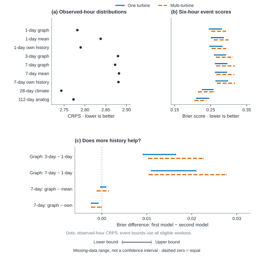

## Joint dependence: intervention, thresholds, distance and strong baseline

Frozen marginal-preserving intervention results, all 880 origins. (a) Time/space/both shuffles; the spatial one-turbine zero is a negative control. (b) Primary one-turbine/time and auxiliary joint-event/space contrasts at raw thresholds 8/10/12. (c) One-turbine time contrast at each window offset, threshold 10. (d) Graph minus analog under identical coupling, threshold 10; positive favors the analog. Seed=mean and repeat=mean average per-seed/per-permutation losses. Finite shuffling does not establish exact independence.

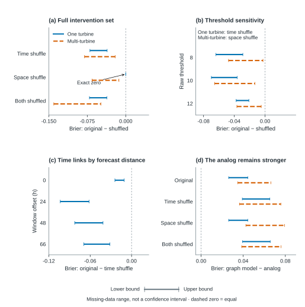

## Two missing-input mechanisms and the complete-input cohort

Panels (a–b): the single frozen training-period joint mask, with natural-input refit64 calibration; visibility uses the last 24 h and CRPS uses observed target hours. Panels (c–d): the separate synchronous 0/6/12/24 h outage test on 392 origins with complete natural inputs, single-turbine 6 h events. Labels and natural calibration stay unchanged. At 0 h all own-score differences are exactly zero. At 24 h, outputs are constant across origins within fold/model/seed: a fixed prior, not real-time spatial information.

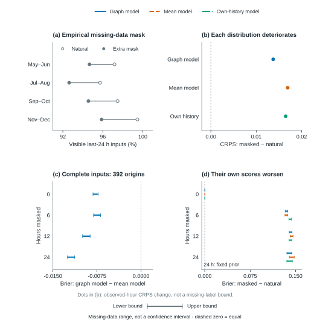

## Rolling calibration: seasonal score and decision trade-offs

Rolling28 versus FixedMonth on frozen forecasts re-evaluated with original float64 labels. (a) One- and multi-turbine Brier bounds by bimonthly fold. (b) ALL error-count differences divided by all forecast records; false alarms and missed windows use the same denominator, not conditional classification rates. (c) Single-turbine accepted-window composition at probability threshold 0.8, also divided by all records. FixedMonth is frozen preceding-month affine calibration; Rolling28 is weekly updated 28-day affine calibration using matured history. These are not Residual28 and not refit64.

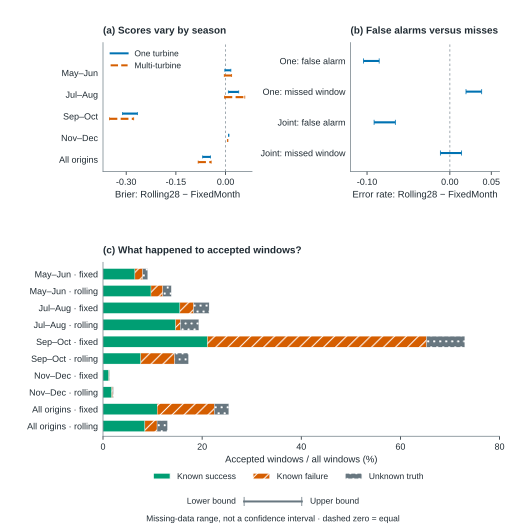

## Label precision and evidence propagation

Three-state labels use original float64 strict-hour truth: known exceedance takes priority over missingness. Seven single-window records, corresponding to two unique physical windows, change from pass to fail; group labels are unchanged. Panel c summarizes the maximum natural-input probability change over frozen folds and producer seeds when historical calibration is refitted at raw precision, separately from the evaluation-only label correction. Partial five-minute evidence fixes 494 unknown turbine–hours as failed but intersects only one matched physical window (three rank rows). It cannot confirm pass from incomplete non-exceeding records.

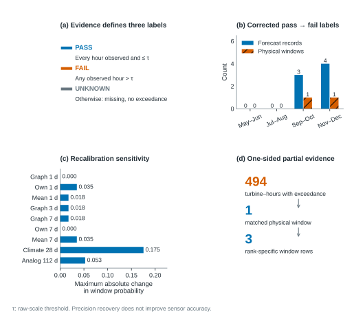

## Residual calibration and acceptance trade-offs

Residual28 is compared with Rolling28_Base49 using frozen predictions reevaluated with raw64 labels. This branch uses different B/W28 aliases from FixedMonth/Rolling28 in the execution study. Panel a uses shared-label paired identification bounds, not target-block sampling envelopes. Panels b–c show all-59,840 single-window decisions at mean probability ≥0.8. G28 selects correction strength by past average performance; K6 uses similar wind state and forecast disagreement. Known success, failure and unresolved accepted records remain separate. Brier is averaged after scoring each seed; decisions threshold the seed-mean probability. Residual28 is not an execution-cross arm.

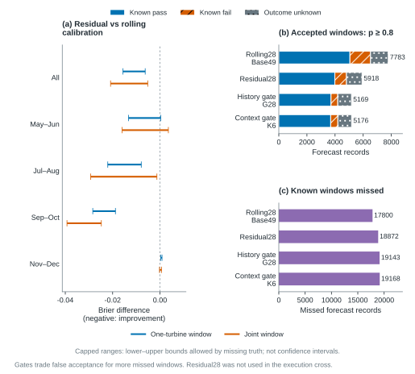

## Cohort composition and observation support

The prediction study has 880 origins; the 392-origin subset has all 17 turbines observed throughout the prior 24 h. The execution study separately has 44 origins, of which 15 have complete task-node weather over 72 h. Panel b uses calendar months, rather than the two-month folds. Record counts in panel c pool offsets and therefore exceed distinct physical-window counts. Panel d reports hour observation rates and matched-label known rates, whose denominators differ. Complete-case selection is descriptive; no missingness model or external validation is implied.

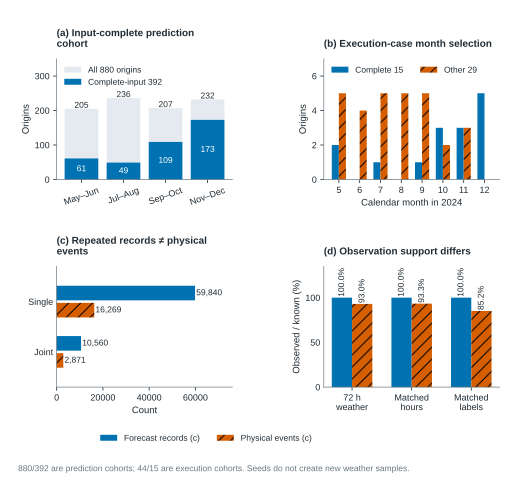

## Matched update mechanisms and influence

The four matched cells use analog/graph and initial/current probabilities on the same eligible task windows. Panel a reports analog minus graph; panel b and panels c–d report the difference in update improvements, positive when graph improves more. Start0 is an unchanged-forecast control. All 44 leave-one-origin results are retained in chronological order. Rank sensitivity uses the same weather, not independent replications. Event weighting changes the estimand; partial evidence fixes only known exceedances. The existing leave-fold figure remains essential: removing Sep–Oct makes the interaction cross zero. Bounds are conditional identification ranges, not confidence intervals.

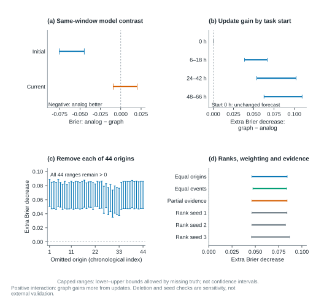

## Cost, service and season

AnalogFixed minus GraphFixed, fixed B resources/actions, lookahead72 and penalty multiplier 1. All 44 origins, four bimonthly folds (11 origins each), and the auxiliary 15 complete-weather origins are shown. Caps mark feasible endpoints, not confidence limits. Cost and successful-task bounds are optimized separately and are not a joint rectangle. Gray complete-subset endpoints collapse to exact values. Attempted tasks and operation task-hours count successful, failed and unknown attempts; they have separate units. Three seeds are averaged within each origin; the complete subset is seasonally selected (2/1/4/8 origins).

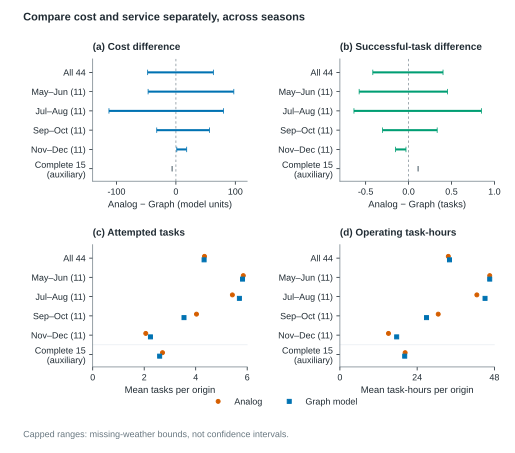

## Booking and information layers

The complete 2 calibrations × 2 executors × 2 booking layers are preserved on all 44 strict-truth origins. Fixed/rolling calibration denote B (FixedMonth)/W28 (Rolling28); both receive current forecasts every 6 h; one-step/72 h denote myopic/lookahead72. Blue/orange ranges are implementable saved execution costs; gray ranges are ideal-recourse hindsight references under the corresponding booking, not online competitors. These are saved coarse cost ranges, not shared-hour paired treatment effects or confidence intervals. C compares the B resource vector with W28 own booking, with seed averaging inside origins; binary boat/crew quantities and spare counts are displayed as mean booked units. D counts attempts, including failures and unknown results. Own booking changes resources and cannot be interpreted as a pure calibration effect.

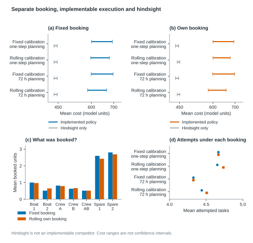

## Scenario-support failures

Strict float64 truth re-evaluation for AnalogFixed and GraphFixed. A/B show failure among known all-scenario-feasible (p=1) windows and success among known all-scenario-infeasible (p=0) windows; labels give numerator/known denominator, with unknown counts separately reported. Initial and current queues are not identical populations. C compares saved fixed-action execution cost bounds with the frozen scenario-support cost range: solid segments are certified outside support; hatched extensions are additional possible cases, not an independent category to add twice. D retains cases with unresolved execution cost. Each executed arm has 132 origin-seed cases from 44 origins; seeds and repeated windows are not independent weather. This diagnoses support, not calibrated coverage probabilities.

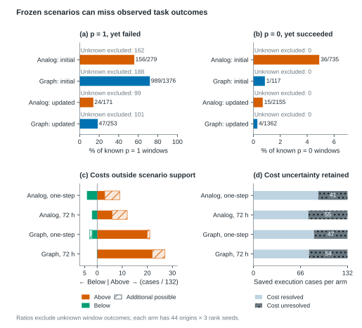

## Shared-weather and penalty identification

A preserves all seven saved comparisons: calibration changes are W28 (Rolling28) minus B (FixedMonth) at fixed executors; both receive current forecasts every 6 h; planning changes are lookahead72 minus myopic at fixed calibrations; analog contrasts are AnalogFixed minus GraphFixed; the final combined row changes own booking too. Squares/circles show coarse/shared-hour widths, not effect estimates. All seven shared bounds cross zero. B/C use the exact primary fixed-action identity D=C+λP with C=2045/3168 and P in [−530/11,2060/33]. The exact lower-bound root is λ*=409/30528. Analog costs strictly more for 0≤λ<λ*, the lower endpoint is zero at the root, and direction is unresolved above it. The upper bound remains positive for all λ≥0, so analog savings are never guaranteed. No reoptimization or scaling of booking/operating/late-start charges is performed.

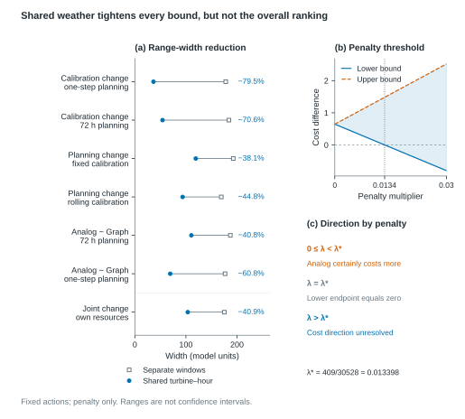

## Value of individual recovery packages

All 88 maximal consecutive essential-hour packages on the same turbine are retained. Each package was queried alone against the same current primary width 110.6061; guarantees are not additive and no optimal multi-package search was performed. A shows total guaranteed reduction; B divides that value by package length. P026: 6 records, reduction 3.4091; P027: 18 records, same 3.4091; P029: 1 record, reduction 3.3333. The 25 zero-guarantee packages can still help for particular returned states; zero is a worst-case guarantee, not proof of no information. Coincident points overlap; the CSV retains every package. All requested states must resolve for the certificate to apply.

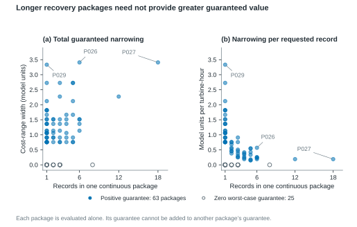

## Scenario equivalence and dominated-support reduction

Frozen-instance engineering validation from scenario_equivalence_v1 (32 runs) and support_dominance_v1 (16 runs). Eight fixed first/last cases across the four development folds, two algorithms, historical 228-scenario inputs and rho=0.25. Grouping is exact only because all scenario-dependent recourse enters through the entire task feasibility vector; it retains all zero-nominal-mass classes. Dominance pruning removes only exactly zero-mass classes with checked retained witnesses and restores the original support for verification. The four last-position cases use nonuniform mass. (a) Counts are algorithm-invariant. (b) Every success/failure is shown with rows matching (a). (c) Each dot is one comparison whose two saved runs are COMPLETE and whose source certificates pass; failed pairs have no objective difference. Differences are numerical residuals, not statistical intervals. Historical cross-round timings are not compared. These objectives retain their historical labels and costs and do not enter the raw64 current-policy evidence.

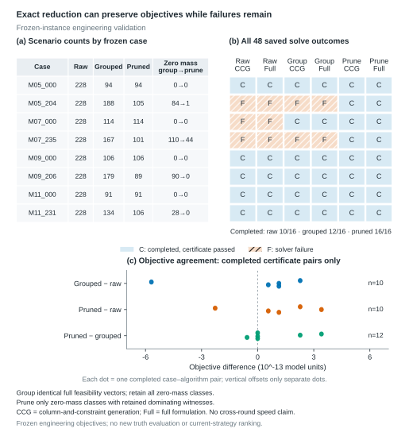

## Bounded-formulation solver stability on frozen inputs

Frozen-instance engineering validation, using only the root runs.csv/comparisons.csv/summary.csv of bounded_distribution_v1 (16 saved requests, not the subsequent repeat run). Two fixed cases M07_235/M09_206 each use raw and UI-normalized weight representations, two algorithms (column-and-constraint generation and full formulation), and original/bounded formulations, rho=0.25. All outcomes are retained: original 5/8 complete, bounded 8/8 complete. In the five pairs with passing saved certificates on both sides, bounded minus original objective is exactly zero in the CSV. Three original solver failures are explicitly unpaired, never assigned a zero objective. This supports only the fixed formulation/inputs. The later cost-scale guard rejects unsupported positive monetary quantities below 0.0001; arbitrary small-rho numerical stability remains outside this evidence. Historical truth/cost definitions are not revised and these engineering objectives do not rank current policies. No time comparison or general completion probability is inferred.

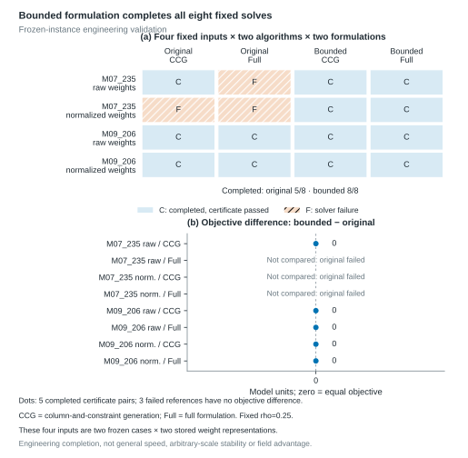

## Why joint predictions matter

Identical hourly probabilities can imply different uninterrupted work windows. In this two-scenario illustration, each hour has a 50% probability of being at or below the threshold. The probability that all six hours qualify is 50% on the left and 0% on the right. Rows are equally weighted scenarios; columns are consecutive hours. These are illustrative values, not experimental results.

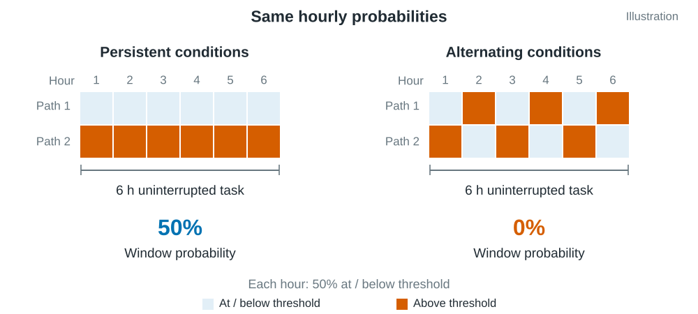

## Joint prediction, windows and constrained scheduling

Implemented mechanism. (a) Fixed-neighbor aggregation and a gated causal temporal encoder map 24 h of three-channel observations to 19 ordered hourly-maximum proxy values per turbine. Calibration and historical residual-rank coupling produce 57 equally weighted joint paths. (b) At a task start, p is the fraction of paths satisfying the threshold at every required hour; the three-path, six-hour example is illustrative, not a measured forecast. Actual task durations are 6 or 12 h. (c) Over the feasible task/start choices, planning maximizes the sum of expected avoided task penalties minus task costs, respecting fixed resource and turbine constraints; only current starts are committed and planning repeats every 6 h. (d) Dashed links use outcome evidence for retrospective evaluation only. Missing truth yields identification bounds, not confidence intervals. Threshold units remain unverified.

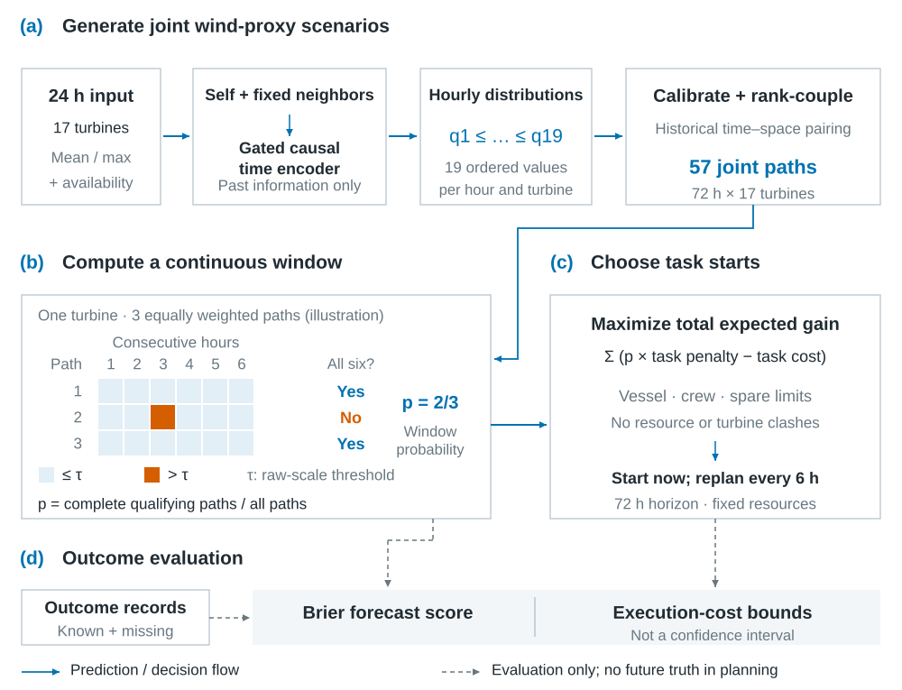

## Baseline comparisons

Graph minus comparison Brier bounds for single-turbine 6 h windows. The graph, farm-mean and own-history models share 24 h inputs; climate and analog baselines use longer histories. Natural inputs, refit64 calibration, 880 origins, 17 turbines and offsets 0/24/48/66 h. Zero means equal loss; bounds are not confidence intervals.

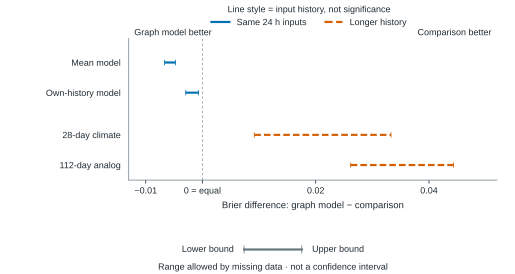

## Dependence and seasonal reversal

Selected dependence tests with unchanged marginals. (a) Time shuffling changes one-turbine windows; space shuffling changes multi-turbine windows but leaves one-turbine windows exactly unchanged. (b) Original minus time-shuffled Brier across bimonthly folds: Sep–Oct reverses direction. Graph model, raw threshold 10, pooled offsets, 880 origins. Bounds are not confidence intervals.

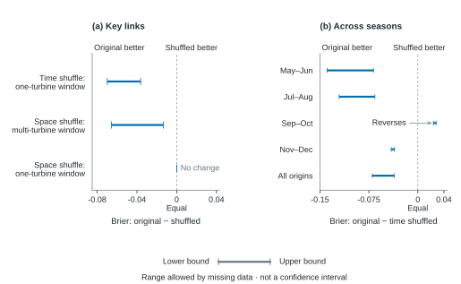

## Calibration and planning cost evidence

Every cost-difference bound crosses zero. Rolling/fixed calibration denote Rolling28/FixedMonth; both receive current forecasts every 6 h; Graph model denotes GraphFixed (= FixedMonth), and analog denotes AnalogFixed (112-day history). One-step/72 h planning denote myopic/lookahead72. Each row is first minus second, conditional on fixed B resources and saved actions, over 44 origins with three rank seeds. Lines are shared-weather identification bounds, not confidence intervals. The analog–Graph model 72 h comparison is primary; its bound is [−47.5363, 63.0698].

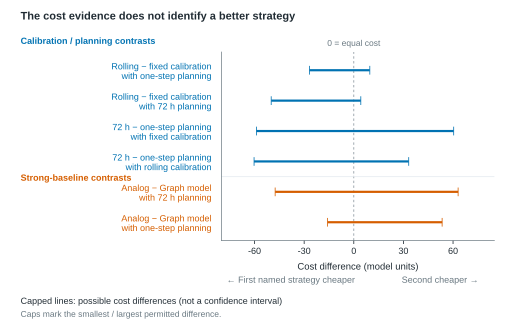

## Value of targeted data retrieval

Primary AnalogFixed minus GraphFixed cost comparison, 72 h planning and fixed B resources/actions. (a) Enforcing shared physical weather reduces width from 186.9697 to 110.6061; the current bound [−47.5363,63.0698] still crosses zero. (b) Three fixed request orders; cost-impact-first ordering (coefficient_sensitivity) at budget 48 yields worst remaining width 71.1364, a guaranteed reduction of at least 35.6849% only if all 48 states are resolved by valid evidence. One state is one turbine at one hour, not a continuous hour; no new observations have arrived and the actual bound is unchanged.

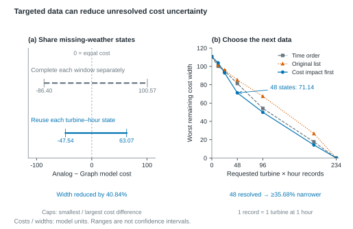

## Chronological protocol

Four chronological folds separate training, validation (Val), calibration (Cal) and evaluation. Evaluation periods are May–Jun, Jul–Aug, Sep–Oct and Nov–Dec; all are 2024 development data, not an independent year. Shapes show time roles, not sample counts. Normalization and graph construction use training data; calibration targets precede evaluation origins.

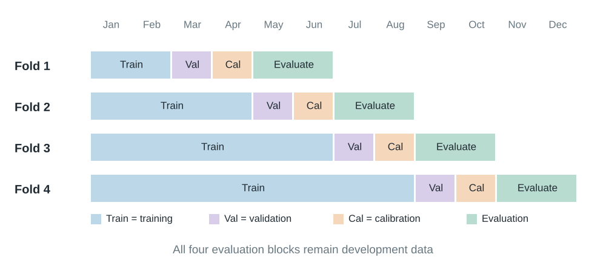

## Dependence interventions

Dependence interventions shown as two-scenario illustrations. Each grid has two equally weighted scenarios and six consecutive hours; blue cells are at/below the threshold and orange cells exceed it. Single denotes the full six-hour window at A; Both requires the same window at A and B. Every intervention preserves per-hour marginal values. Space shuffling preserves single-turbine trajectories. The real experiment uses 57 scenarios and three fixed shuffle repetitions, not the two illustrated paths.

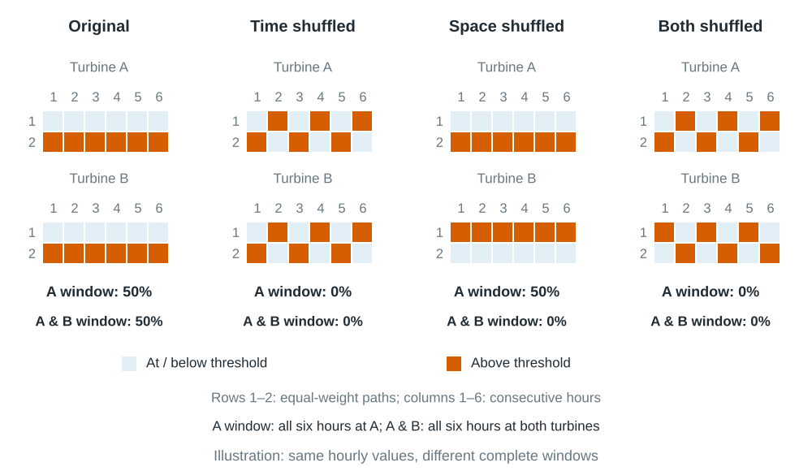

## Forecast updates and heterogeneity

Matched updates on the same targets. (a) Both methods improve after updating. (b) The graph model’s extra improvement crosses zero when Sep–Oct is removed. Raw float64, shared unknown hours and equal-origin weights; 44 origins and 9,150 seed windows. All 44 leave-one-origin and three single-seed contrasts stay positive. These are influence checks, not independent validation; bounds are not confidence intervals.

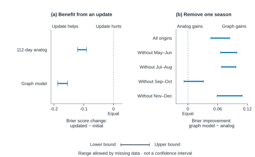

## Threshold and outage robustness

Relative advantage versus absolute deterioration, single-turbine 6 h windows, all 880 origins. (a) Graph minus farm-mean loss at raw thresholds 8/10/12 and after 0/6/12/24 h synchronous input masking. (b) Each model’s own missing-minus-natural loss. Complete-input 392-origin checks also favor Graph and are retained in the data file. Natural-input calibration is frozen. At 24 h, zero inputs yield a fixed prior, not real-time spatial evidence. Zero means equal loss; bounds are not confidence intervals.

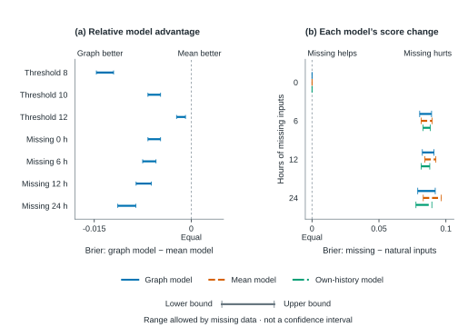

## Cost sensitivity and task outcomes

AnalogFixed versus GraphFixed, 72 h planning, fixed B resources and saved actions, all 44 origins × three rank seeds. (a) Only nonnegative unmet/failed-task penalties are multiplied by the displayed weights; booking and entire operating costs, including late-start charges, stay fixed. Shading shows exact cost bounds, not a confidence band or reoptimized policies. No nonnegative weight guarantees analog savings. (b) All four mean task outcomes are retained. The successful-task difference bound is [−0.4167,0.4015], separately optimized from cost.

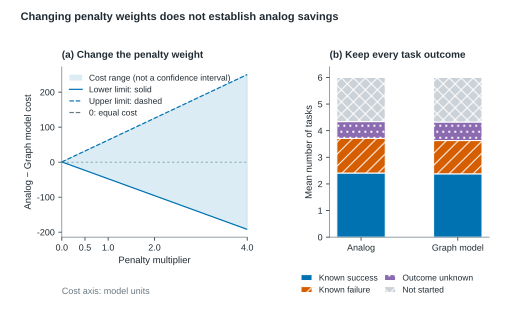