# 实验地图与完整图集

[方法](research.zh.md) · [核心证据](evidence.zh.md) · [代码导航](code-map.zh.md) · [English](experiments.en.md)

26组公开图按下表阅读。图组不等于独立实验；同一实验可能有主图与补充图。全部数值来自开发资料，图示中的示例路径不代表实测。

| 主题 | 图组（点击打开SVG） |
|---|---|
| 研究主线 | [fig01_motivation](../figures/zh/fig01_motivation.svg), [fig02_workflow](../figures/zh/fig02_workflow.svg), [supp01_protocol](../figures/zh/supp01_protocol.svg) |
| 基线与标签 | [fig03_baselines](../figures/zh/fig03_baselines.svg), [exp01_baseline_landscape](../figures/zh/exp01_baseline_landscape.svg), [exp05_label_precision](../figures/zh/exp05_label_precision.svg), [exp07_sample_selection](../figures/zh/exp07_sample_selection.svg) |
| 联合与更新 | [fig04_dependence](../figures/zh/fig04_dependence.svg), [exp02_joint_evidence](../figures/zh/exp02_joint_evidence.svg), [supp02_dependence_design](../figures/zh/supp02_dependence_design.svg), [supp03_updates](../figures/zh/supp03_updates.svg), [exp08_update_diagnostics](../figures/zh/exp08_update_diagnostics.svg) |
| 校准与缺测 | [exp03_missing_inputs](../figures/zh/exp03_missing_inputs.svg), [exp04_rolling_calibration](../figures/zh/exp04_rolling_calibration.svg), [exp06_residual_calibration](../figures/zh/exp06_residual_calibration.svg), [supp04_robustness](../figures/zh/supp04_robustness.svg) |
| 执行与证据 | [fig05_execution](../figures/zh/fig05_execution.svg), [exp09_cost_service](../figures/zh/exp09_cost_service.svg), [exp10_resource_information](../figures/zh/exp10_resource_information.svg), [exp11_support_failures](../figures/zh/exp11_support_failures.svg), [exp12_cost_identification](../figures/zh/exp12_cost_identification.svg), [supp05_cost_service](../figures/zh/supp05_cost_service.svg) |
| 补录与工程 | [fig06_acquisition](../figures/zh/fig06_acquisition.svg), [exp14_package_value](../figures/zh/exp14_package_value.svg), [exp15_scenario_reduction](../figures/zh/exp15_scenario_reduction.svg), [exp16_solver_stability](../figures/zh/exp16_solver_stability.svg) |

<!-- EXPERIMENT_NAV_END -->

## 完整基线与历史长度

自然输入、refit64校准下全部九家族。(a)仅已观测小时CRPS点值。(b)相同行序的全体Brier界。(c)预定3/7日历史及7日结构敏感性。880起报、17机组、偏移0/24/48/66h。神经模型三生产种子，统计基线单生产者配固定秩模板，均为开发对照，非选冠军。

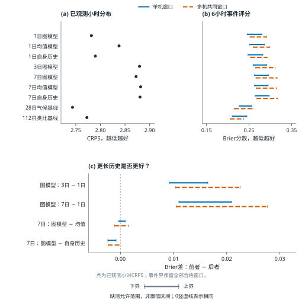

## 联合依赖：干预、阈值、距离与强基线

全880起报的冻结边际保持干预。(a)时间/空间/同时打散，空间打散单机精确零为负控。(b)阈值8/10/12的主单机时间、辅助多机共同空间对照。(c)阈值10各窗口偏移单机时间效果。(d)阈值10相同耦合下图减类比，正值支持类比。先逐种子及排列算损失再平均；有限打散不证明精确独立。

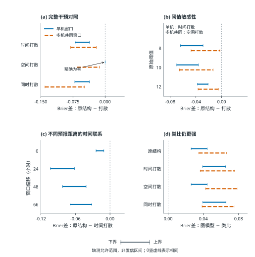

## 两种输入缺测压力与完整输入子群

(a–b)单套冻结训练期联合缺测模板，保留自然输入refit64校准；可见率取末24h，CRPS仅取已观测目标小时。(c–d)另一个同步0/6/12/24h中断实验，限定自然输入完整392起报、单机6h事件。标签和自然输入校准不变。0h各模型自身差精确为零；24h每fold/model/seed输出跨起报常量，为固定先验而非实时空间信息。

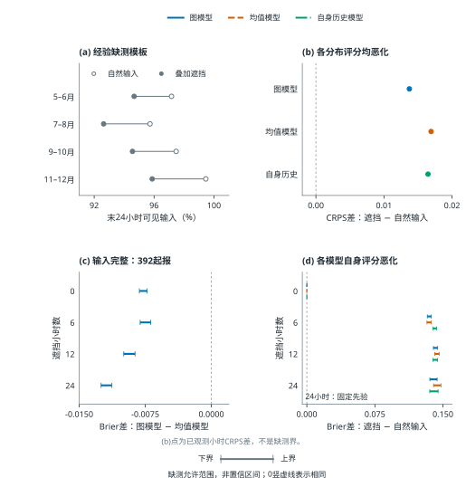

## 滚动校准的季节评分与决策取舍

冻结预测以原始float64真值复评的滚动28日与前月固定校准。(a)各双月fold单机和多机共同Brier界。(b)总体错误数差除全部预测记录，不是条件分类率。(c)0.8概率门槛的单机接受窗口构成，也除全部记录。前月固定为冻结前月仿射校准；滚动28日为仅用成熟历史每周更新的28日仿射校准，均不是Residual28或refit64。

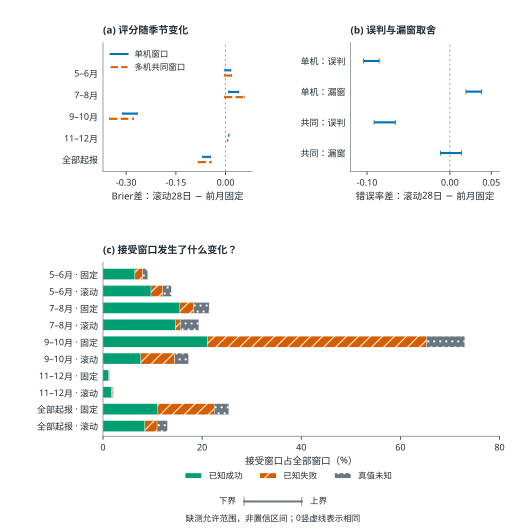

## 标签精度与证据传播

三值标签使用原始float64严格小时真值，已知超限优先于缺测。7条单机窗口记录对应2个去重物理窗口，从成功修正为失败；共同窗口标签不变。c图为自然输入下校准按原始精度重拟合后，各既定fold与生产种子的窗口概率最大变化，与仅重评标签区分。部分5分钟记录可将494个未知机组小时固定为失败，但只与1个匹配物理窗口相交，对应3条秩种子记录。不完整且未超限的记录不能确证成功。

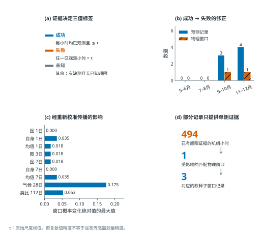

## 残差校准与窗口接受的取舍

固定预测以raw64标签重评，Residual28与Rolling28_Base49比较。本分支B/W28身份不同于执行实验的FixedMonth/Rolling28。a图使用共享标签配对识别界，不绘目标分块外包。b–c图展示全部59840条单机窗口在种子平均概率≥0.8下的决策。G28按过去平均表现选校正力度，K6使用相似风况与预测分歧。接受后的已知成功、失败和未知分开保留。Brier先逐种子计分再平均，决策以平均概率阈值化；Residual28不属于执行交叉臂。

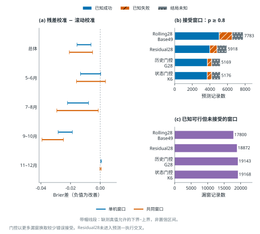

## 队列构成与观测支持

预测研究共880起报，其中392起报在此前24小时内17机组输入完整。执行研究另有44起报，其中15起报的72小时任务节点天气完整。b图按实际日历月而非双月fold统计。c图预测记录跨偏移汇总，数量大于去重物理窗口。d图小时观测率和匹配标签已知率分母不同。完整案例选择仅作描述，不暗示建立缺测机制模型或完成外部验证。

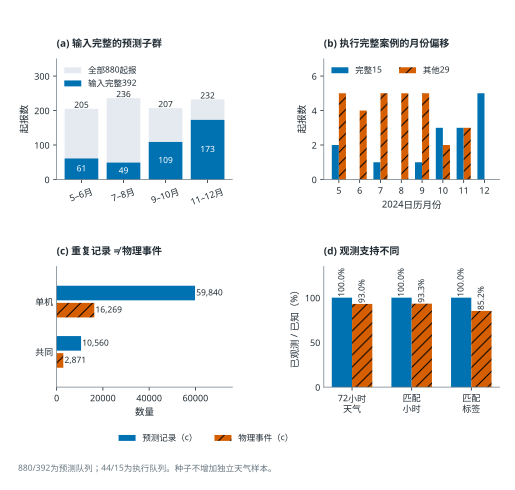

## 同窗更新机制与影响诊断

四格将类比/图模型与初始/当前预报在同一合格任务窗口上匹配。a图为类比减图的Brier差；b–d图为更新改善量之差，正值表示图改善更多。start0为预报未变负控。44个留一起报结果全部按时间展示。秩种子使用相同天气，不是独立重复；事件权重改变估计目标，部分证据只固定已知超限。仍需结合已有留fold图：剔除9–10月后交互跨零。所示为条件识别范围，不是置信区间。

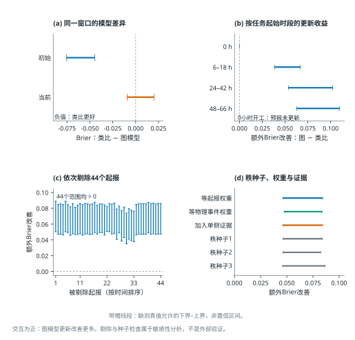

## 费用、服务与季节

类比减图模型，固定B资源及动作、lookahead72、罚损倍数1。展示全44起报、四个双月fold（各11）及完整天气15起报辅助子集。端帽为可行端点而非置信限；费用与成功任务数分别优化，不能拼成联合矩形。灰色完整子集界退化为确定值。尝试量与操作任务小时包含成功、失败和结局未知的尝试，单位分开。每起报内平均3套秩；完整子集在四fold分布为2/1/4/8。

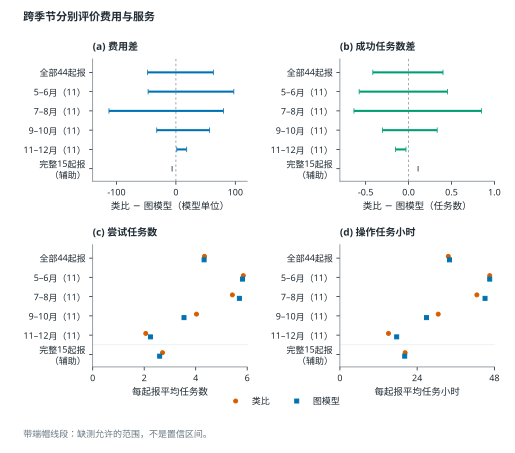

## 预订与信息层次

完整保留2种校准×2种执行器×2层预订的八臂，全部44起报采用严格真值复评。固定/滚动校准为B（FixedMonth）/W28（Rolling28），两者都每6小时接收当前预报；即时/72小时为myopic/lookahead72。蓝/橙范围是可实施的保存执行费用，灰色是对应预订下的理想追补后见参照，不是在线竞争策略。这些为保存的粗费用界，不是共享小时配对因素效应或置信区间。C比较B资源向量与W28自身预订，船/人员二元预订及备件数均表示平均预订数量。D尝试数包含失败及结局未知的启动。自身预订改变资源，不能解释为纯校准作用。

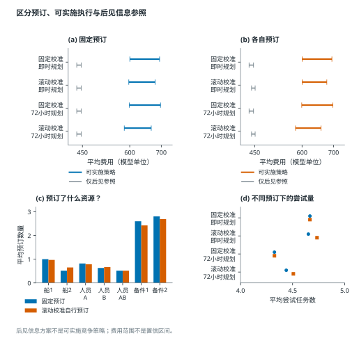

## 情景支持失配

类比与图模型采用严格float64真值复评。A/B分别为全部情景可行（p=1）且结局已知窗口中的失败，以及全部情景不可行（p=0）且结局已知窗口中的成功；标注分子/已知分母，另列未知数。初始与更新队列不是相同总体。C以保存固定动作费用界对比冻结情景支持费用范围：实色段为确证越界，斜纹延伸为额外可能越界，不重复计数。D保留执行费用未确定的案例。每臂132个起报—种子案例来自44起报，重复窗口与种子不是独立天气。此图诊断支持失配，不给覆盖概率保证。

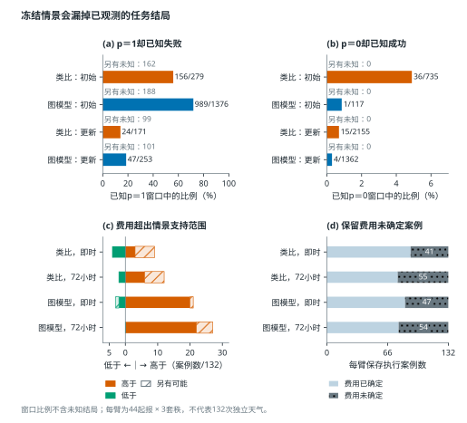

## 共享天气与罚损方向识别

A保留七项保存比较：校准变化为固定执行器下W28（Rolling28）减B（FixedMonth），两者均每6小时接收当前预报；规划变化为固定校准下lookahead72减myopic；类比对比为AnalogFixed减GraphFixed；最后整体变化还改变自身预订。方块/圆点是粗界/共享小时界的宽度，不是效应点估计。七项共享界都跨零。B/C采用主比较固定动作精确式D=C+λP，C=2045/3168，P范围[−530/11,2060/33]。下界精确根λ*=409/30528；0≤λ<λ*时类比确定更贵，根处下端点为0，根以上方向无法识别。所有λ≥0的上界均为正，因此不能保证类比更省费用。不重新优化，也不缩放预订、运营或迟开工收费。

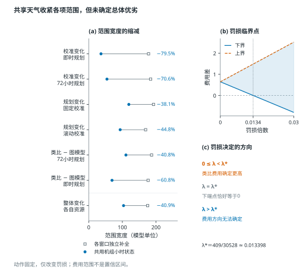

## 单个连续补录包的价值

完整保留同一机组必要小时组成的88个最大连续段，每段均对当前主费用范围宽110.6061单独评价。保证不能相加，没有求最优多包组合。A为总保证缩窄，B为该值除以段长。P026含6条、缩窄3.4091；P027含18条、同为3.4091；P029仅1条、缩窄3.3333。25个零保证包在特定返回状态下仍可能有帮助，0仅指最坏保证，不证明没有信息。重合点可能覆盖，CSV保留全部88段；证书适用需请求状态全部解析。

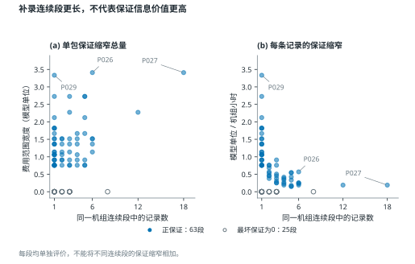

## 情景等价归并与支配支持删减

来自scenario_equivalence_v1的32次和support_dominance_v1的16次冻结实例工程验证。四开发fold各首末实例共8个，2算法，历史228情景、rho=0.25。归并精确性以全部情景追补差异仅通过完整任务可行向量进入为条件，并保留所有名义零质量组。支配删减仅移除严格零质量且具有已核查保留证人的组，核验时恢复原支持。四个末例使用非均匀质量。(a)情景计数与算法无关。(b)行序与(a)一致，全部成功失败均显示。(c)仅两侧保存状态均COMPLETE且源证书通过的配对给出目标差，失败配对不造目标差。差值为数值残差，非统计区间。不比较跨轮时间；历史标签费用未更新，因此不加入raw64当前策略证据。

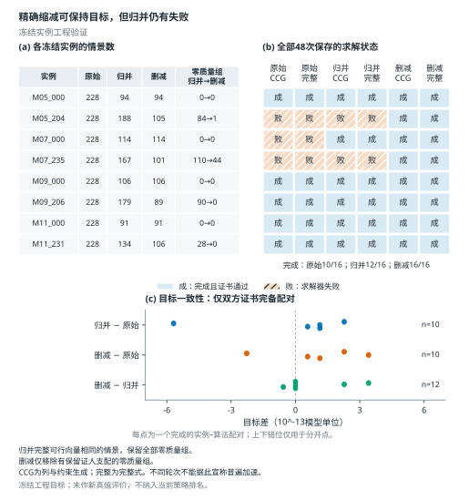

## 冻结输入的有界式求解稳定性

冻结实例工程验证，仅使用bounded_distribution_v1根目录runs.csv/comparisons.csv/summary.csv的16个保存请求，不混入后续重复轮。M07_235/M09_206两实例各有原权重与UI归一化权重表示，2算法（列与约束生成、完整式）、原式/有界式，rho=0.25。保留全部状态：原式5/8完成，有界式8/8完成。两侧保存证书均通过的5配对，其有界减原式目标在CSV中恰为0；3个原式求解失败明确不配对，不给其伪造零目标差。该结果只支持指定输入及形式。后续费用尺度护栏拒绝小于0.0001的不支持正货币量，任意极小rho数值稳定仍不在此证据内。未修正历史标签费用，不将工程目标纳入当前策略排名。不据此推断时间倍数或一般完成概率。

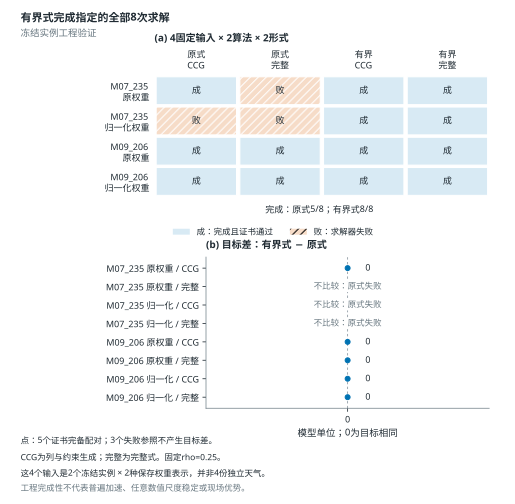

## 为何需要联合预测

逐小时概率相同，不代表连续作业窗口概率相同。两组示意中，每小时均有50%概率不超阈值，但连续六小时全部满足条件的概率分别为50%和0%。行是等权情景，列是连续小时；图中数值仅作原理演示，不是实验结果。

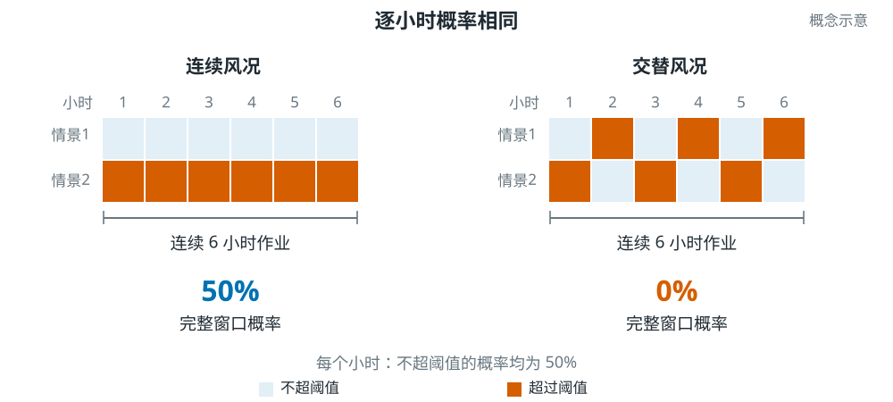

## 联合预测、窗口概率与受约束调度

实际实现的机制。(a)固定邻居汇聚与门控因果时序编码将24小时三通道观测转成每机组每小时19个有序的小时最大值代理取值，再经校准与历史残差秩耦合形成57条等权联合情景。(b)在每个候选开工时点，p为任务所有小时均满足阈值的情景比例；三情景、六小时例子仅用于演示，不是测得的预报。实际任务持续6或12小时。(c)在可行任务/开工选择上，最大化期望避免罚损减作业成本之和，遵守固定资源及机组约束；仅承诺当前开工，每6小时重排。(d)虚线只把结果证据用于回顾评价。缺测真值给出识别上下界，不是置信区间，阈值单位仍待核实。

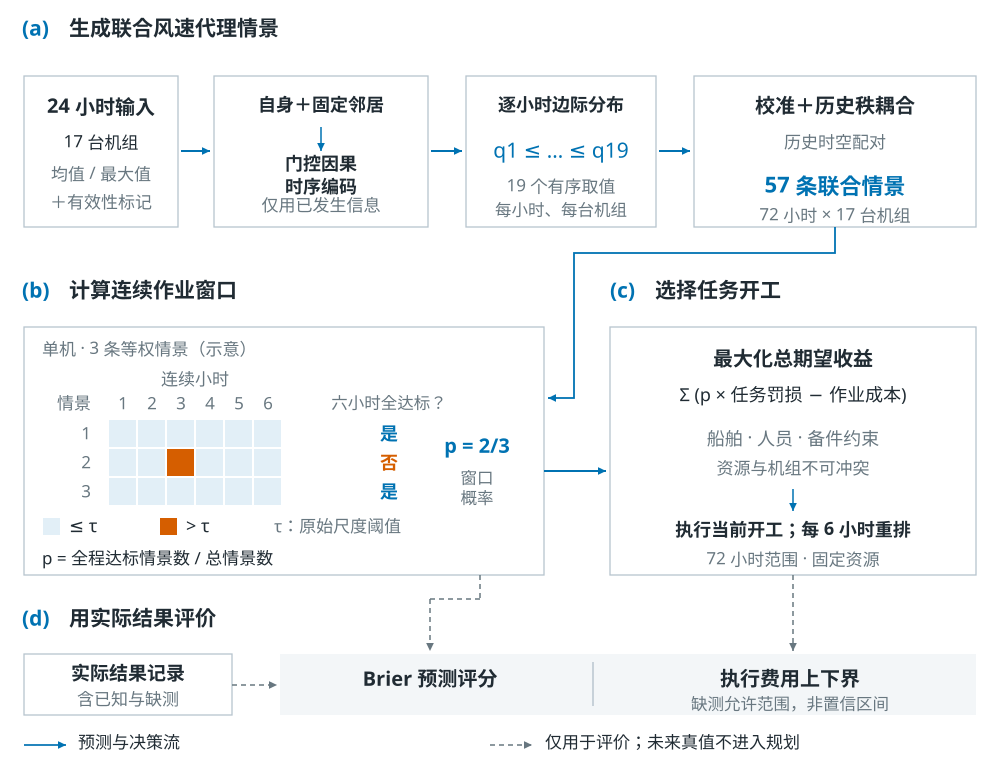

## 基线比较

单机6h窗口图模型减对照的Brier界。图、全场均值及自身历史模型共用24h输入；气候与类比基线用更长历史。自然输入、refit64校准，880起报、17机组、偏移0/24/48/66h。零表示损失相同，区间不是置信区间。

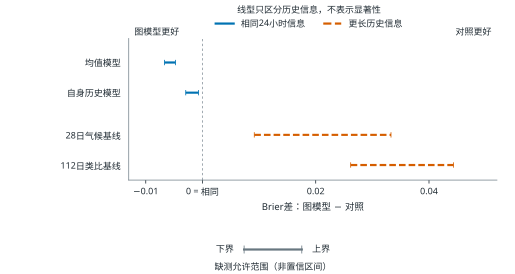

## 依赖作用与季节反例

边际不变的关键依赖对照选集。(a)时间打散影响单机窗口；空间打散影响多机共同窗口，单机窗口精确不变。(b)原结构减时间打散的双月fold结果，9–10月方向反转。图模型、原始阈值10、合并偏移、880起报。识别界不是置信区间。

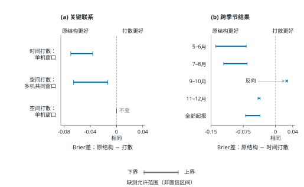

## 校准与规划费用证据

所有费用差识别范围均跨零。滚动/固定校准分别为Rolling28/FixedMonth，两者均每6小时接收当前预报；图模型为GraphFixed（即FixedMonth），类比为112日历史的AnalogFixed；即时/72小时规划分别为myopic/lookahead72。各行均为前者减后者，固定B资源与保存动作，44起报、每起报3套秩。线段不是置信区间。主比较为72小时规划下类比减图模型，范围[−47.5363,63.0698]。

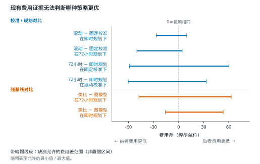

## 定向补录的价值

主比较为类比减图模型费用差，72小时规划、B资源与动作固定。(a)共享物理天气使范围宽度从186.9697降至110.6061，但当前范围[−47.5363,63.0698]仍跨零。(b)三种固定请求排序中，费用影响优先排序（coefficient_sensitivity）补录48个机组×小时状态后最坏剩余宽为71.1364；只有全部48个状态被有效证据解析，才保证至少缩窄35.6849%。每个状态是一台机组在一个小时的天气，不是连续48小时；目前没有新增观测，实际费用范围不变。

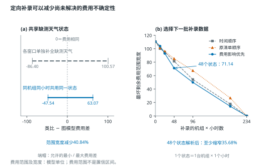

## 时间隔离规程

四折均按时间顺序分开训练、验证、校准与评价，评价段依次为5–6、7–8、9–10、11–12月。全部来自2024开发资料，不是独立年度外验。色块表达时间用途，不代表样本数；标准化和图构建使用训练资料，校准目标先于评价起报。

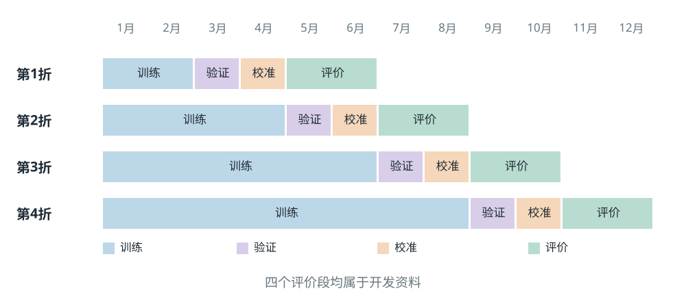

## 依赖干预原理

联合结构干预示意。每个小矩阵有两个等权情景、六个连续小时；浅蓝不超阈值，橙色超阈值。“单机”要求A机组完整六小时满足，“两机共同”要求A、B在相同六小时均满足。每种干预保持逐小时边际取值，空间打散还保留单机轨迹。正式实验使用57情景及三次固定打散，非图中两个示意情景。

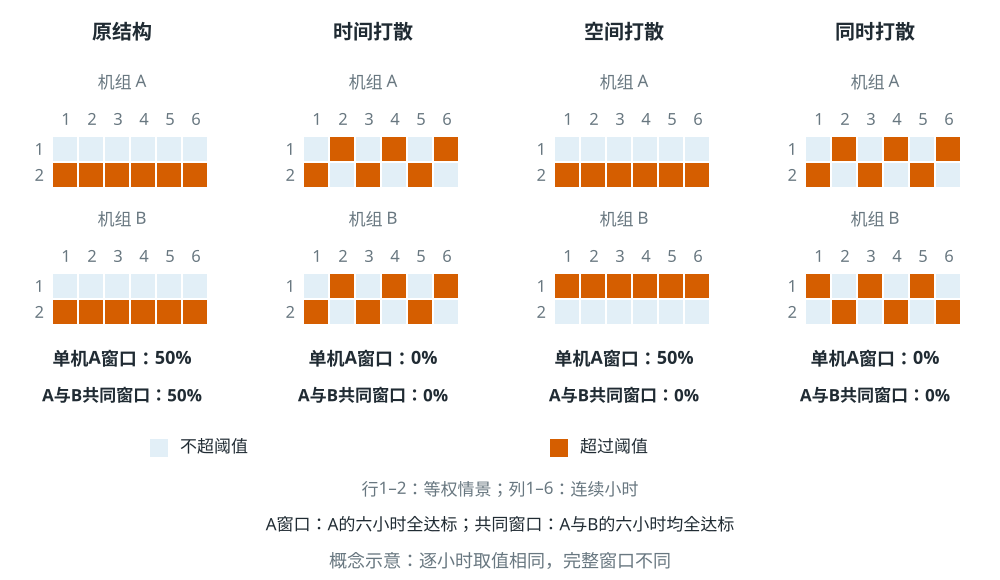

## 更新收益及其异质性

相同目标上的匹配更新。(a)两方法更新后均改善。(b)图模型的额外改善在删除9–10月后跨零。原始float64、共享未知小时、等起报权重，44起报、9,150种子窗口。44留一起报与三单种子对照全正。这是影响诊断，非独立验证；区间不是置信区间。

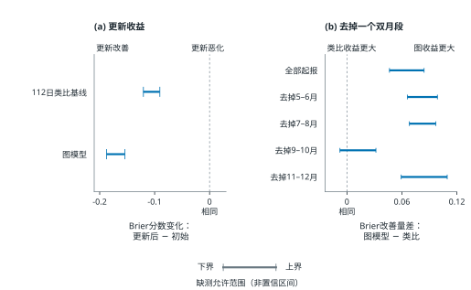

## 阈值与缺测稳健性

相对优势与自身恶化，单机6h、全880起报。(a)原始阈值8/10/12及0/6/12/24h同步输入遮挡下图减均值损失。(b)各模型自身缺测减自然输入损失。输入完整392起报对照也支持图模型，数值保存在数据文件。自然输入校准冻结。24h全零输出是固定先验，非实时空间证据。零表示损失相同；区间不是置信区间。

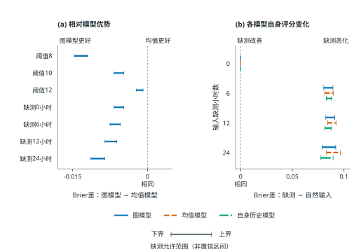

## 费用敏感性与任务状态

类比与图模型采用72小时规划，B资源和保存动作固定，全部44起报×3套秩。(a)仅未完成/失败罚损乘以横轴非负倍数，预订和整个运营费用（包括迟开工收费）不变。阴影为精确费用界，不是置信带，也没有重新优化策略。任何非负权重均不能保证类比更省费用。(b)保留四类平均任务数。成功任务数差的范围为[−0.4167,0.4015]，与费用分别优化。

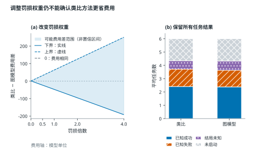