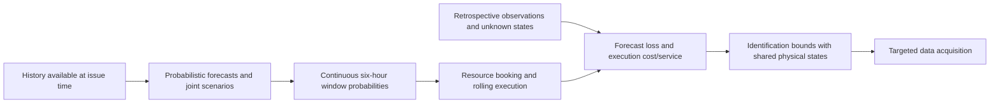

[中文](./research.zh.md) · [English](./research.en.md) · [README](../README.en.md)

# Research questions, methods and progress

## 1. Why continuous windows matter

A maintenance job needs several hours of jointly feasible conditions, as well as vessels, crews, spares and commitments that cannot be undone. Accurate hourly forecasts do not automatically imply accurate window probabilities; better window probabilities do not automatically reduce execution cost. We therefore evaluate forecast quality and decision value separately.

The proposal follows graph construction → 72-hour probabilistic forecasting → robust maintenance scheduling → integrated simulation. The implemented route uses auditable temporal graph aggregation, joint scenarios, continuous windows, constrained execution and partial identification under missing observations. Statistical dependence is not verified physical propagation, and not every proposed architecture has been implemented.

## 2. Three research questions

| Question | Factors separated | Controls | Current interpretation |
|---|---|---|---|
| H1: Does a graph add predictive information? | Structure versus history length | Same-24h graph/mean/own-history; 28-day climate and 112-day analog | Graph improves the matched-information control; the longer-history analog remains stronger |
| H2: Does coupling matter for windows? | Marginals versus dependence | Time, space and combined shuffles preserving each lead/node marginal multiset | Time structure helps overall, with a September–October reversal |
| H3: Do better forecasts improve execution? | Calibration, planning, resources and information | Fixed/rolling calibration × immediate/72h planning; fixed and own bookings separately | Main cost and service ranges cross zero; ranking remains unidentified |

These are research questions, not claims that every hypothesis was confirmed. Negative results, strong-baseline counterexamples and solver failures remain in the record.

## 3. Cohorts and information budgets

| Evaluation object | Size | Role and limitation |
|---|---:|---|
| Forecast origins | 880; 17 turbines | Main forecasting evaluation |
| Complete-input origins | 392 | Matched input-outage experiments, not a replacement population |
| Execution origins | 44 | Main prediction–execution evaluation |
| Complete-weather execution origins | 15 | Seasonally selected auxiliary subgroup |
| Single-turbine forecast records | 59,840 | 16,269 distinct physical targets; repeated targets exist |
| Joint-event records | 10,560 | 2,871 distinct physical targets; repeated targets exist |

Windows last six hours at offsets 0/24/48/66 hours. Neural producers use three seeds; averaging seeds does not add weather observations. All 2024 records have been used for development. Within-year splits must not be relabeled as external validation.

## 4. Three-valued truth and numerical precision

For threshold τ and the observations available in a target window:

- **Failure (0)**: any observed hour exceeds τ, even if other hours are missing.
- **Success (1)**: every required hour is observed and none exceeds τ.
- **Unknown**: no observed exceedance, but at least one required hour remains missing.

Re-evaluating truth from original float64 values changed seven forecast records representing two physical windows. Float32 model inputs and original-precision evaluation truth are separate. This does not improve sensor accuracy. Thresholds 8/10/12 remain in unverified original units, not validated offshore operating limits.

## 5. Window probabilities from joint scenarios

For scenario s, turbine n, start t and duration L, define:

`E_s(t,n) = 1{all required scenario values in the window are at most τ}`.

For equally weighted scenarios, `p(t,n) = mean_s E_s(t,n)`. A multi-turbine event additionally intersects the required turbines. The calculation retains within-scenario temporal and spatial alignment; it does not multiply hourly marginal probabilities.

Dependence interventions alter only joint rank arrangements and certify equality of each lead/node marginal multiset. The exact-zero spatial intervention on a single-turbine event is a negative control. Finite permutations do not establish exact independence. Losses are computed per producer seed/permutation before averaging.

## 6. Separate calibration from forecast refresh

Previous-month fixed calibration and rolling-28-day calibration are different calibration rules. Both execution arms receive current forecasts every six hours. Residual28 is a separate residual-calibration branch and was not used in this fixed/rolling execution cross. Calibration history, forecast refresh and planning horizon must not be conflated.

The matched-window update experiment holds the physical target fixed while crossing analog/graph models and initial/current forecasts. Let AI, GI, AC and GC denote their four Brier cells. The primary interaction is `(AC−GC)−(AI−GI) = (GI−GC)−(AI−AC)`: positive means the graph gains more Brier reduction from updating, not that it beats the analog on current forecasts. The pooled interaction is positive, but removing September–October makes its range cross zero. See supp03 and exp08 in the [figure atlas](experiments.en.md).

## 7. Execution and partial identification

The research executor considers bookings, vessel/crew conflicts, spares, tasks and irrevocable attempts. Immediate and 72-hour planning are compared with fixed resources; own booking belongs to a separate comparison. Forecasts and actions are frozen before retrospective truth is used.

For every completion z compatible with known observations, form the paired difference `Δ(z)` and report `[min_z Δ(z), max_z Δ(z)]`. A turbine-hour shared by overlapping windows has one common state. It cannot be assigned independently in each window. Enforcing this consistency tightens bounds without creating observations.

Cost and successful-task differences are bounded separately; their ranges do not form an arbitrary jointly attainable rectangle. Penalty sensitivity revalues fixed actions rather than reoptimizing at each penalty. Identification ranges are not confidence intervals, and costs use model units. Sampling uncertainty must be reported separately.

## 8. Acquisition and engineering checks

The main cost comparison needs 234 turbine-hour states. Resolving the first 48 validly guarantees at least a 35.68% reduction in the current main width. Another 146 states are retained for other fair comparisons. This conditional value does not mean data have arrived, ranking has changed, or money has been saved. It is not a globally optimal adaptive-query claim.

Engineering work includes scenario-equivalence grouping, zero-mass dominated-support pruning and bounded cost formulations. Of 16 frozen requests, the original formulation completed 5/8 and the bounded formulation 8/8. The five mutually completed, certified pairs have zero objective difference; three failed original references have no paired objective value. This result applies only to the fixed inputs tested.

## 9. Status and remaining limits

Existing-data work covers labels, baselines, dependence, calibration, outages, updates, execution, acquisition and engineering, with manuscript materials, figures and a prototype. Next are field/time semantics, frozen rescoring and independent-year/real-operation validation. Further same-year model selection is paused.

The proposal runs June 2026–May 2028, with an original midterm milestone in May 2027. Materials reflect November 3, 2026; the formal review date is unconfirmed. This repository does not establish a published paper, granted patent or registered software copyright.

Continue: [Evidence](evidence.en.md) · [Code map](code-map.en.md) · [Reproducibility](reproducibility.en.md) · [Data roadmap](roadmap.en.md)
