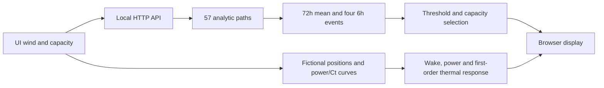

[中文](./twin.zh.md) · [English](./twin.en.md) · [README](../README.en.md)

# Digital-twin prototype and public synthetic runtime

## Two systems

| Capability | Local research prototype | Public synthetic edition |
|---|---|---|
| 3D turbines and environment interaction | Available | Available, 12 fictional turbines |
| Power, wake and thermal response | Available | Illustrative, uncalibrated parameters |
| Annual observations and historical replay | Private environment | Not included |
| 72h probabilities and 6h windows | Research forecasts/replay | 57 analytic synthetic paths |
| Task execution | Research constraints and retrospective evaluation | Threshold plus capacity truncation |
| Real layout, telemetry and fitted weights | Private | Not included |

“Digital twin” here refers to visualization and response modules of a research prototype. The public edition has no field calibration, live telemetry synchronization or real vessel interface. It is not a deployable maintenance decision system.

## Quick start

```sh
python demo/server.py
```

Run from the repository root and open `http://127.0.0.1:8788`. Windows users can double-click [start_demo.cmd](../start_demo.cmd). Requirements are Python 3.10+ and a WebGL browser; no third-party Python packages. Three.js and controls are bundled without a runtime CDN dependency. Stop with Ctrl+C.

## Suggested walkthrough

1. Inspect the 3D farm, rotate the camera and zoom.
2. Adjust synthetic wind speed and observe power, wake loss and first-turbine bearing temperature.
3. Inspect the 72-hour mean and four six-hour window probabilities; a mean does not determine a joint event.
4. Change task capacity to distinguish qualifying probabilities from selected windows.
5. Switch Chinese/English and state that every displayed scenario is synthetic.

Selection takes windows with `p ≥ 0.8` in start-time order, then truncates to capacity. It does not run the full robust optimizer, actual routing, maintenance costs or resource-conflict scheduling. Zero capacity must produce no selected windows.

## Modules and data flow



| File | Responsibility |
|---|---|
| [demo/server.py](../demo/server.py) | Localhost server for `demo/static` and the synthetic API |
| [demo/core.py](../demo/core.py) | Analytic paths, three-valued labels, window probabilities and example selection |
| [viewer.js](../demo/static/viewer.js) | Interaction, interface and display updates |
| [site-data.js](../demo/static/site-data.js) | Generated positions and hypothetical parameters |
| [model.js](../demo/static/model.js) | Power interpolation, first-order temperature and Jensen/Park wake calculations |
| [farm.js](../demo/static/farm.js) | 3D turbines and rotor dynamics |

Response parameters and power/Ct curves are uncalibrated. The demo threshold of 10 belongs to its illustrative wind environment; the empirical field threshold of 10 still has unverified units. One does not validate the other.

## Local API

`GET /api/scenario?wind=8&crews=2`

| Parameter | Accepted values | Default | Meaning |
|---|---|---|---|
| `wind` | Number 0–25 | 8 | Synthetic path baseline |
| `crews` | Integer 0–4 | 2 | Maximum selected-window count |

Response fields are `synthetic: true`, anonymized `site`, `windows` (starts 0/24/48/66 and probabilities), `selected` (chosen starts), `mean` (72 means) and an explanatory `policy`. Out-of-range inputs return HTTP 400. The request does not access observed data.

## Troubleshooting

| Symptom | Action |
|---|---|
| Python is missing | Install/select Python 3.10+ and check `python --version` |
| Port 8788 is occupied | Stop your previously started demo; there is currently no port CLI flag |
| Opening HTML directly fails | Use the local Python server instead of `file://` module loading |
| Blank 3D area | Use a WebGL browser; inspect hardware acceleration and browser console |
| Old interface persists | Hard-refresh and confirm the server belongs to the current checkout |
| Numbers differ from the paper | Expected: the demo is synthetic; paper figures summarize frozen empirical work |

The server binds only 127.0.0.1 and has no authentication, TLS or production configuration. It is for local demonstration, not public hosting. Bundled Three.js retains its [MIT attribution](../demo/static/LICENSE-three.txt).
