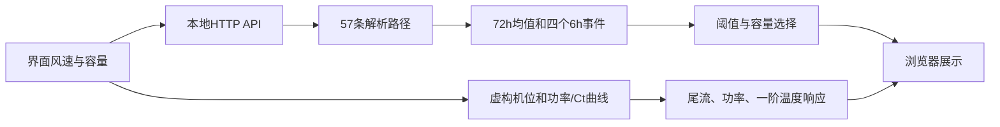

[中文](./twin.zh.md) · [English](./twin.en.md) · [README](../README.md)

# 数字孪生原型与公开合成运行版

## 两类系统

| 能力 | 本地研究原型 | 公开合成版 |
|---|---|---|
| 三维机群、环境交互 | 有 | 有，12台虚构机组 |
| 功率、尾流、温度响应 | 有 | 有，未标定的示意参数 |
| 年度实测与历史回放 | 私有环境支持 | 不包含 |
| 72h概率与6h窗口 | 研究输出与回放 | 57条解析合成路径 |
| 任务执行 | 研究约束模型及复盘 | 阈值＋容量截断规则 |
| 真实布局、遥测、权重 | 私有 | 不包含 |

“数字孪生”在本仓库指研究原型的可视化和响应模块。公开版没有现场标定、在线遥测同步或真实船舶业务接口，不是可直接部署的运维决策系统。

## 快速启动

```sh
python demo/server.py
```

从仓库根目录执行，浏览器打开`http://127.0.0.1:8788`。Windows也可双击[start_demo.cmd](../start_demo.cmd)。需要Python 3.10+及WebGL浏览器；无需第三方Python依赖。Three.js和控制器随包提供，启动后无需从CDN加载。Ctrl+C停止。

## 建议演示顺序

1. 观察三维机群，拖动旋转视角并缩放。
2. 调整合成环境风速，查看功率、尾流损失和首机轴承温度的响应。
3. 查看72小时均值和四个6小时窗口概率，注意均值并不决定窗口事件。
4. 调整任务容量，比较概率达标与最终被选中窗口的区别。
5. 切换中英文，说明所有值均来自合成示例。

公开选择规则按起点顺序取`p ≥ 0.8`的窗口，再按容量截断。它未调用完整鲁棒求解器，没有真实航线、维修费用或资源冲突排程。容量为0应没有选中窗口。

## 模块与数据流



| 文件 | 职责 |
|---|---|
| [demo/server.py](../demo/server.py) | 仅绑定localhost，服务`demo/static`及合成API |
| [demo/core.py](../demo/core.py) | 解析路径、三值标签、窗口概率与示例选择规则 |
| [viewer.js](../demo/static/viewer.js) | 交互、界面与展示更新 |
| [site-data.js](../demo/static/site-data.js) | 程序生成机位及假设参数 |
| [model.js](../demo/static/model.js) | 功率插值、一阶温度、Jensen/Park尾流计算 |
| [farm.js](../demo/static/farm.js) | 三维机群与叶轮动态 |

物理响应参数和功率/Ct曲线没有现场标定。演示阈值10使用示例环境的风速刻度；研究原始字段阈值10的单位仍待核实，两者不可互相验证。

## 本地API

`GET /api/scenario?wind=8&crews=2`

| 参数 | 合法值 | 默认 | 含义 |
|---|---|---|---|
| `wind` | 数值0–25 | 8 | 合成路径的风速基准 |
| `crews` | 整数0–4 | 2 | 示例选中窗口数量上限 |

返回字段：`synthetic: true`、匿名`site`、`windows`（起点0/24/48/66及概率）、`selected`（选中起点）、`mean`（72个均值）和说明规则的`policy`。超出上述范围的参数返回HTTP 400。请求不读取实测数据库。

## 常见问题

| 现象 | 处理 |
|---|---|
| 找不到Python | 安装/选择Python 3.10+；终端先检查`python --version` |
| 8788端口占用 | 关闭自己先前启动的演示，再重试；脚本当前没有端口参数 |
| 双击HTML页面不工作 | 通过Python本地服务打开，不使用`file://`直接运行模块 |
| 三维区域空白 | 用支持WebGL的浏览器，检查硬件加速和浏览器控制台 |
| 页面还是旧版 | 强制刷新；核对终端运行的是当前仓库中的服务 |
| 数值不同于论文 | 这是预期：演示是合成流程，论文图来自冻结实证汇总 |

演示服务器只绑定127.0.0.1，没有认证、TLS或生产部署配置。适合本机演示，不应自行改成公网服务。Third-party Three.js按[随附MIT许可](../demo/static/LICENSE-three.txt)保留归属。
